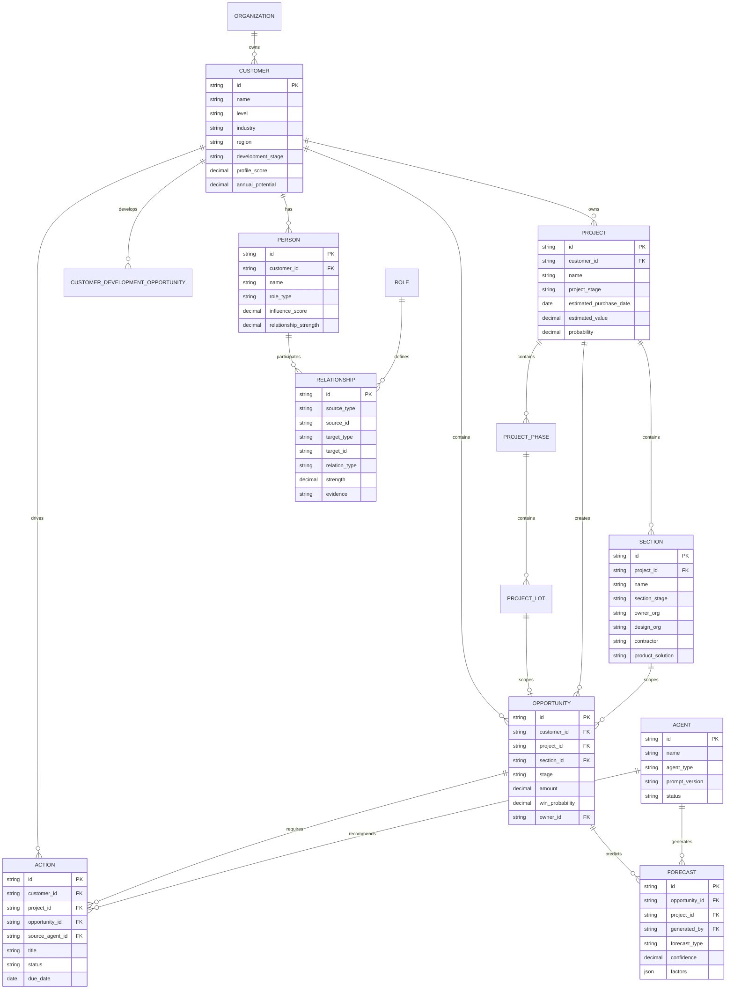

# AI Native CRM 数据模型与关系设计

## 1. 设计目标

本模型用于统一新版销售工作台、旧版治理后台和 Agent 能力的数据底座。它不把商机当作孤立记录，而是把销售经营链路建模为：

```text
客户 → 项目 → 项目标段 → 商机 → 产品方案
  ↘ 关键人 / 关系
  ↘ Action 行动
商机 → Agent 推理 → Forecast 预测
```

销售填写业务事实，语义规则负责解释字段含义，Agent 负责分析和生成行动，Action 的结果再回写客户、项目和商机。

## 2. ER 关系图



### P0 对象的兼容落点

本轮 P0 实现采用渐进迁移，不删除旧对象：

- `Organization` 落在 `organizations`，`customers.organization_id` 指向客户主体组织；现有 `customer_organizations` 继续承担客户内部组织树的兼容职责。
- `CustomerDevelopmentOpportunity` 复用并扩展 `customer_development_opportunities`。原有 `customer_development_id + opportunity_id` 关联记录继续有效；新增 `customer_id`、`target`、`opportunity_type`、`stage`、`owner` 和 `probability` 后，可以保存尚未绑定项目商机的客户级开发机会。
- `ProjectPhase` 落在 `project_phases`，`ProjectLot` 落在 `project_lots`。旧 `project_sections` 保留，通过 `project_lots.legacy_section_id` 建立迁移映射。
- `Opportunity` 新增 `project_lot_id`，旧 `project_section_id` 不删除；初始化时会为已有标段建立项目期和项目标段，并回填商机映射。

## 3. 核心表结构

### Customer 客户

| 字段 | 类型 | 业务含义 |
|---|---|---|
| id | string PK | 客户唯一标识 |
| name | string | 客户名称 |
| level | enum | 战略客户 / 重点客户 / 普通客户 |
| industry | string | 所属行业 |
| region | string | 区域 |
| development_stage | enum | AT1-AT6 |
| profile_score | decimal | AI 客户画像评分 |

### CustomerProfile（画像快照）

`customers` 继续保存客户主数据；`customer_profiles` 保存可刷新、可版本化的画像投影。除既有版本、完整度和置信度字段外，当前实现增加：`value_score`（价值评分）、`growth_potential`（增长潜力）、`construction_area`、`land_reserve_area`、`customer_level`、`expires_at`。事实写入 `customer_profile_facts`，预测继续追加到 `customer_value_predictions` / `customer_growth_predictions`，刷新时仅把最新结果映射到画像快照，不覆盖原始事实。

画像读取返回 `quality` 与 `qualityWarnings`；置信度低于 60、事实低置信度、画像超过 30 天或无已发布摘要时给出提示。历史版本通过 `GET /api/customers/{id}/profile-history` 查询，刷新仍使用现有 `POST /api/customer-profiles/{id}/refresh`。

### Role 与统一 Relationship

`roles` 是角色字典，`relationships` 通过 `role_id`、来源、关系状态和最近互动时间保存 Person 与 Customer、Project、Opportunity、Organization 的统一关系。原有 `customer_persons`、`project_persons`、`opportunity_persons` 不删除，初始化时幂等回填到统一关系；旧 API 继续读取旧表，新 `/api/relationships` 读取统一关系并返回 `role`、`source`、`lastInteractionAt`。同一实体对与关系类型使用唯一约束，重复同步只更新投影，不产生重复关系。
| profile_completeness | decimal | 画像完整度 |
| annual_potential | decimal | 年度业务潜力 |
| risk | text | 当前经营风险 |
| ai_summary | text | AI 客户摘要 |
| ai_recommended_action | text | AI 推荐策略 |

### Organization 组织

| 字段 | 类型 | 业务含义 |
|---|---|---|
| id | integer PK | 组织唯一标识 |
| parent_id | integer FK | 父级组织，支持集团和区域公司层级 |
| code | string unique | 组织编码 |
| name | string | 组织名称 |
| organization_type | string | 客户主体、集团、区域公司、项目公司等 |
| industry | string | 所属行业 |
| region | string | 所属区域 |
| status | enum | active / inactive / archived |

### CustomerDevelopmentOpportunity 客户开发机会

| 字段 | 类型 | 业务含义 |
|---|---|---|
| id | integer PK | 客户开发机会唯一标识 |
| customer_id | integer FK | 所属客户 |
| customer_development_id | integer FK nullable | 可选的客户开发主线 |
| opportunity_id | integer FK nullable | 可选的项目商机 |
| target | string | 客户级经营目标 |
| opportunity_type | string | 集采突破、战略客户开发、增购机会等 |
| stage | enum | 目标定义 / 关系建立 / 方案植入 / 集采推进 / 复盘 |
| owner | string | 责任人 |
| probability | decimal | 客户级开发成功概率，范围 0-1 |
| status | enum | active / completed / abandoned |
| next_action | text | 下一步行动 |

### ProjectPhase 项目期

| 字段 | 类型 | 业务含义 |
|---|---|---|
| id | integer PK | 项目期唯一标识 |
| project_id | integer FK | 所属项目 |
| phase_name | string | 一期、二期、三期等 |
| status | enum | planned / active / completed / cancelled |
| sequence | integer | 项目期顺序 |
| start_date / end_date | date | 计划起止日期 |

### ProjectLot 项目标段

| 字段 | 类型 | 业务含义 |
|---|---|---|
| id | integer PK | 标段唯一标识 |
| phase_id | integer FK | 所属项目期 |
| lot_name | string | 标段名称 |
| scope | text | 标段范围 |
| amount | decimal | 标段预计金额 |
| status | enum | planned / bidding / awarded / active / completed / lost |
| legacy_section_id | integer unique nullable | 旧 `project_sections` 映射 ID |

### Project 项目

| 字段 | 类型 | 业务含义 |
|---|---|---|
| id | string PK | 项目唯一标识 |
| customer_id | string FK | 所属客户 |
| name | string | 项目名称 |
| project_stage | enum | 机会 / 设计 / 招标 / 施工 / 交付 |
| location | string | 项目地点 |
| owner | string | 项目负责人 |
| estimated_value | decimal | 项目规模金额 |
| estimated_purchase_date | date | 预计采购时间 |
| probability | decimal | AI 项目成交概率 |
| risk_level | enum | 低 / 中 / 高 |
| next_milestone | string | 下一里程碑 |

### Section 项目标段

| 字段 | 类型 | 业务含义 |
|---|---|---|
| id | string PK | 标段唯一标识 |
| project_id | string FK | 所属项目 |
| name | string | 标段名称 |
| stage | string | 标段当前阶段 |
| owner_org | string | 甲方 |
| design_org | string | 设计院 |
| contractor | string | 总包 |
| agent_org | string | 代理商 |
| product_solution | string | 产品方案 |
| estimated_amount | decimal | 标段预计金额 |

### Opportunity 商机

| 字段 | 类型 | 业务含义 |
|---|---|---|
| id | string PK | 商机唯一标识 |
| customer_id | string FK | 所属客户 |
| project_id | string FK | 所属项目 |
| section_id | string FK | 所属标段 |
| name | string | 商机名称 |
| opportunity_type | string | 商机类型 |
| stage | enum | 商机报备 / 商机确认 / 商机跟踪 / 标前引导 / 成交 |
| amount | decimal | 商机金额 |
| win_probability | decimal | AI 成交概率 |
| product_solution | string | 产品方案 |
| competitor | string | 竞品 |
| blockers | json | 当前阻塞事项 |
| ai_recommendation | text | AI 推进建议 |
| owner | string | 商机负责人 |

### Person 关键人

| 字段 | 类型 | 业务含义 |
|---|---|---|
| id | string PK | 人员唯一标识 |
| customer_id | string FK | 所属客户 |
| name | string | 姓名 |
| title | string | 职位 |
| role_type | enum | 经济买家 / 采购 / 技术 / 业务发起人 / 项目负责人 |
| influence_score | decimal | 影响力评分 |
| relationship_strength | decimal | 关系强度 |
| relationship_status | enum | 待建立 / 跟进中 / 已建立 |

### Relationship 关系

Relationship 使用多态关联，支持客户、项目、标段、商机、人员和组织之间的关系。

| 字段 | 类型 | 业务含义 |
|---|---|---|
| id | string PK | 关系唯一标识 |
| source_type | string | 起点对象类型 |
| source_id | string | 起点对象 ID |
| target_type | string | 终点对象类型 |
| target_id | string | 终点对象 ID |
| relation_type | string | owns / influences / designed_by / contracted_by 等 |
| strength | decimal | 关系强度 |
| evidence | text | 关系证据 |
| last_verified_at | datetime | 最近验证时间 |

### Agent 智能体

| 字段 | 类型 | 业务含义 |
|---|---|---|
| id | string PK | Agent 唯一标识 |
| name | string | Agent 名称 |
| agent_type | string | 客户洞察 / 商机推进 / 项目预测 / 方案生成 |
| input_objects | json | 可读取的对象范围 |
| output_types | json | 可生成的洞察、Action 或 Forecast |
| prompt_version | string | Prompt 版本 |
| status | enum | 运行中 / 停用 |

### Action 行动

| 字段 | 类型 | 业务含义 |
|---|---|---|
| id | string PK | 行动唯一标识 |
| customer_id | string FK | 关联客户 |
| project_id | string FK | 关联项目 |
| opportunity_id | string FK | 关联商机 |
| source_agent_id | string FK | 生成行动的 Agent |
| title | string | 行动标题 |
| type | string | 客户会议 / 关系突破 / 事实核验 / 方案评审 |
| assignee | string | 执行人 |
| priority | enum | 高 / 中 / 低 |
| due_date | date | 截止日期 |
| status | enum | 待执行 / 进行中 / 已完成 |
| reason | text | AI 推荐理由 |
| result | text | 执行结果 |

### Forecast 预测

| 字段 | 类型 | 业务含义 |
|---|---|---|
| id | string PK | 预测唯一标识 |
| opportunity_id | string FK | 关联商机 |
| project_id | string FK | 关联项目 |
| generated_by | string FK | 生成预测的 Agent |
| forecast_type | enum | 成交概率 / 采购时间 / 金额预测 |
| forecast_value | json | 预测值 |
| confidence | decimal | 预测置信度 |
| factors | json | 影响因素和解释 |
| generated_at | datetime | 生成时间 |
| valid_until | datetime | 预测有效期 |

## 4. 现有 Mock 数据映射

现有 `src/mock/` 已经覆盖核心对象，字段映射如下：

| ER 对象 | Mock 文件 | 关键关联字段 |
|---|---|---|
| Customer | `src/mock/customers.json` | `projectIds`, `keyPersonIds` |
| Project / Section | `src/mock/projects.json` | `customerId`, `sectionIds`, `sections[].opportunityId` |
| Opportunity | `src/mock/opportunities.json` | `customerId`, `projectId`, `sectionId` |
| Person | `src/mock/persons.json` | `customerId`, `projectIds` |
| Action | `src/mock/actions.json` | `opportunityId`, `projectId`, `sourceAgentId` |
| Agent | `src/mock/agents.json` | `id` 被 Action 引用 |
| Relationship | 后续由关系 API / 图谱数据承载 | 建议统一使用 `source/target` 结构 |
| Forecast | 后续由预测 API / Agent 输出承载 | 建议按商机和项目分别保存 |

## 5. 约束与规则

1. `Opportunity` 必须至少关联 `Customer`，工程行业商机应同时关联 `Project` 和 `Section`。
2. `Section` 不脱离 `Project` 独立存在，产品方案优先挂在标段层。
3. `Person` 不仅是联系人，还要通过 `role_type` 和 `Relationship` 表示其在决策链中的作用。
4. AI 生成的 `win_probability`、`profile_score` 和 `Forecast` 必须保留生成时间、Agent 和影响因素。
5. 所有 AI 建议都应能生成 `Action`，并在 Action 完成后回写结果。
6. 关系不能只保存“有无关系”，还要保存强度、证据和最近验证时间。
7. 删除业务对象时不直接删除历史 Action、Forecast 和 Relationship，应保留审计记录。

## 6. 对新版与旧版的支撑

- 新版销售工作台读取 Customer、Project、Section、Opportunity、Person、Action 和 Forecast。
- 旧版治理后台维护对象字段、Relationship 语义、Agent 配置和预测规则。
- 两者通过统一 ID、统一 API 和统一事实来源字段共享数据。
- 销售录入业务事实，治理人员配置规则，Agent 负责解释和推荐行动。

